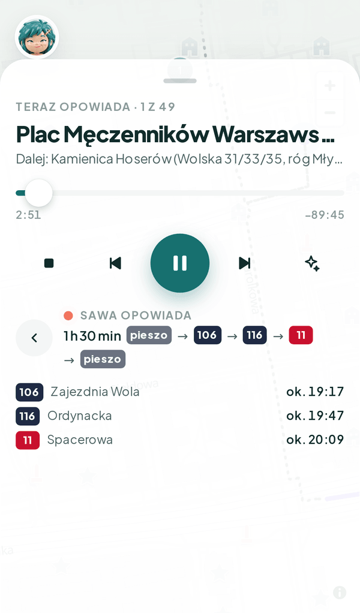

<div align="center">


# Sawa

**Syrenka-przewodniczka, która wie, co masz za oknem tramwaju.**

🔗 **[sawa-hackathon.vercel.app](https://sawa-hackathon.vercel.app)** · najlepiej na telefonie (działa jako PWA)

Warsaw Open Data Hackathon 2026 · 17–18.10 · 42 Warsaw

</div>

| Poznaj Sawę | Ile masz czasu? | Trasa i opowieść | Przesiadki i odjazdy |
|:---:|:---:|:---:|:---:|
|  |  |  |  |

## Problem

Według prognozy miasta w 2060 r. ok. 20% mieszkańców Warszawy to będą imigranci i ich potomkowie, a codziennie przyjeżdża tu ok. 600 tys. osób spoza miasta ([docs/08-badania-trendy.md](docs/08-badania-trendy.md)). Przyjezdni codziennie jeżdżą tymi samymi liniami, ale nie wiedzą nic o mijanych ulicach, a przewodniki i audioprzewodniki są pisane dla turystów i ich wyznaczonych tras, a nie dla zwykłego dojazdu do pracy.

## Rozwiązanie

Sawa planuje przejazd komunikacją miejską pod Twoje zainteresowania i czas, a w trakcie jazdy opowiada o miejscach, które właśnie mijasz. Długość każdej opowieści dopasowuje do czasu dojazdu do następnego miejsca, liczonego z rozkładu ZTM i pozycji pojazdów na żywo.

### Jak to działa

1. **Onboarding:** wybierasz zainteresowania (historia, kultura, sport, przyroda), to, jak dobrze znasz miasto, i styl opowieści. Bez konta, profil zostaje w telefonie.
2. **Trasa:** podajesz czas albo cel. Planer układa przejazd tramwajami i autobusami ZTM (z odcinkami pieszymi) tak, żeby po drodze było jak najwięcej miejsc pasujących do Ciebie.
3. **Jazda:** mapa pokazuje trasę, przystanki i pojazdy na żywo, a Sawa milczy, dopóki nie zbliżysz się do pierwszego miejsca.
4. **Opowieść:** przy każdym miejscu LLM układa krótką opowieść wyłącznie z faktów z naszej bazy (każdy ze źródłem). Opcjonalnie czyta ją głos Sawy. Sawa pamięta, co już słyszałeś, i nie powtarza się.

## Dane

### Zbiory z dane.um.warszawa.pl

| Zbiór | Endpoint (`/api/action/…`) | Do czego | Licencja |
|---|---|---|---|
| Lokalizacja pojazdów komunikacji miejskiej | `get_ztm_lokalizacja_pojazdow` | pojazdy na mapie na żywo, opóźnienie i prognoza dojazdu (korki) | CC BY, ZTM |
| Odjazdy linii z przystanku | `get_ztm_odjazdy_linii_z_przystanku` | godziny odjazdów z rozkładu dla każdego odcinka trasy | CC BY, ZTM |
| Otwarte boiska | `get_be_otwarte_boiska` | ok. 300 szkolnych terenów sportowych jako miejsca w kategorii „sport” | CC BY |

Zapytania do API miasta idą tylko z naszego backendu (token `WAW_TOKEN`), przeglądarka nie łączy się z nim bezpośrednio. Podpisy źródeł są w odpowiedziach API (`attribution`) i w aplikacji.

### Inne otwarte źródła

| Źródło | Do czego | Licencja |
|---|---|---|
| GTFS Warszawy, [mkuran.pl](https://mkuran.pl/gtfs/) (dane ZTM) | graf linii, przystanki, kształty tras | dane ZTM, kształty © OpenStreetMap (ODbL) |
| OpenStreetMap | zabytki, kościoły, muzea, teatry, parki, obiekty sportowe; geokodowanie (Nominatim) | ODbL |
| Wikipedia, Warszawikia | fakty o miejscach | CC BY-SA |
| [warszawa1939.pl](https://warszawa1939.pl) | karty przedwojennych budynków (Śródmieście, Wola) | CC BY-NC |
| Wikimedia Commons | zdjęcia archiwalne, z autorem i licencją przy każdym | licencja przy zdjęciu |
| OpenFreeMap | podkład mapy | ODbL |
| OSRM (FOSSGIS) | odcinki piesze po chodnikach | ODbL |

Baza ma ok. 3700 miejsc ze źródłami i ok. 800 zdjęć (Supabase, PostGIS). Opis zbierania i licencji: [docs/historia/README.md](docs/historia/README.md), [docs/historia/dzielnice/README.md](docs/historia/dzielnice/README.md).

## Architektura

```
 telefon (PWA)                       Railway                          zewnętrzne
┌────────────────┐  HTTPS  ┌──────────────────────────┐
│  apps/web      │────────▶│  apps/api (Hono, Node)   │──▶ dane.um.warszawa.pl (pojazdy, odjazdy)
│  Next.js       │         │                          │──▶ OpenRouter (LLM opowieści)
│  MapLibre      │         │  planer tras: graf GTFS  │──▶ ElevenLabs (głos, opcjonalnie)
│  Vercel        │         │  w pamięci procesu       │──▶ OSRM (odcinki piesze)
└────────────────┘         │  cache opowieści         │──▶ Google Places (wyszukiwanie celu)
        │                  └────────────┬─────────────┘
        │ podkład mapy                  │ service_role
        ▼                               ▼
   OpenFreeMap              Supabase: Postgres + PostGIS
                            (miejsca, fakty, zdjęcia, źródła)
```

Kontrakt API (zod) jest w `packages/shared` i jest wspólny dla web i api. Przeglądarka nie zna żadnych kluczy: Supabase, API miasta i LLM wołamy tylko z backendu. Szczegóły: [docs/12-plan-mvp.md](docs/12-plan-mvp.md), [docs/05-plan-architektury.md](docs/05-plan-architektury.md).

### Stack

| Warstwa | Technologia | Dlaczego |
|---|---|---|
| Frontend | Next.js (App Router), Tailwind, shadcn/ui, Vercel | szybki start, PWA na telefonie |
| Mapa | MapLibre GL, podkład OpenFreeMap | otwarte, bez klucza API |
| Backend | Hono na Node, Railway | graf linii w pamięci procesu, długie odpowiedzi LLM (bez limitów serverless), sekrety w jednym miejscu |
| Kontrakt | zod w `packages/shared` | jedno źródło typów dla API i web |
| Baza | Supabase (Postgres + PostGIS) | zapytania „miejsca w obszarze / przy trasie” |
| LLM | OpenRouter, `google/gemini-3.5-flash-lite` (port `LlmProvider`, model wymienny) | tani i szybki; bez klucza opowieść to same fakty |
| Głos | ElevenLabs `eleven_multilingual_v2` | naturalny polski; domyślnie wyłączony (`?voice=1`) |
| Jakość | TypeScript `strict`, Vitest, Biome, GitHub Actions | jedna konfiguracja dla 4 osób |

## Użycie AI

Regulamin (§4 ust. 4) wymaga opisu zakresu użycia AI. Za wszystkie treści odpowiada zespół.

**W aplikacji:**

- **Opowieści Sawy** generuje LLM (OpenRouter, `google/gemini-3.5-flash-lite`) na żywo, wyłącznie z faktów z naszej bazy przypisanych do miejsca. Prompt zabrania dopisywania dat, liczb, nazwisk i wydarzeń spoza tych faktów. Bez klucza LLM aplikacja czyta same fakty. Prompty: `apps/api/src/prompts/`.
- **Głos Sawy:** synteza mowy ElevenLabs.

**Przy budowie:**

- **Kod:** każdy z 4 członków zespołu pracował z własnym agentem Claude Code. Kod powstał w czasie hackathonu (od 17.10, 11:00) przez PR-y do `main`. Każdy PR przechodził typecheck, lint i testy w CI, a zmiany przeglądał człowiek.
- **Dane:** skrypty w `scripts/` pobierają dane z OSM, Wikipedii, Warszawikii, warszawa1939.pl i API miasta. Fakty z artykułów Warszawikii wyciągały agenty Claude Haiku. Każdy fakt ma podane źródło.
- **Grafika:** awatar Sawy i jego warianty wygenerowały modele obrazów (fal.ai, m.in. Nano Banana, GPT Image). Wybór i poprawki należały do zespołu ([docs/awatar/](docs/awatar/README.md)).
- **Dokumentacja i plan:** analiza danych, PRD, plany i pitch powstawały razem z agentami ([docs/](docs/README.md)). Do 17.10, 13:30 prowadziliśmy dziennik promptów: [docs/ai-log.md](docs/ai-log.md).

---

## Dla developerów

Dokumentacja zespołu: [docs/README.md](docs/README.md). PRD: [docs/10-prd.md](docs/10-prd.md). Plan MVP: [docs/12-plan-mvp.md](docs/12-plan-mvp.md). Zasady kodu: [docs/11-zasady-pracy-i-kodu.md](docs/11-zasady-pracy-i-kodu.md).

### Wymagania

| Narzędzie | Wersja | Sprawdź |
|---|---|---|
| Node.js | **24 LTS** (min. 24) | `node -v` |
| pnpm | **12.14.0** (zapisana w `package.json`, pole `packageManager`) | `pnpm -v` |
| Git | dowolna aktualna | `git --version` |

#### 1. Node.js 24

**macOS** (Homebrew):

```bash
brew install node@24
brew link --force --overwrite node@24
```

**Windows** (PowerShell):

```powershell
winget install --id OpenJS.NodeJS.LTS -e
```

Potem zamknij i otwórz terminal (i edytor), żeby `node` był w `PATH`.

**Linux / alternatywa dla każdego systemu** ([nvm](https://github.com/nvm-sh/nvm)):

```bash
nvm install 24
nvm use 24
```

#### 2. pnpm 12

Najprościej, na każdym systemie:

```bash
npm install -g pnpm@12.14.0
```

Albo przez Corepack (wbudowany w Node 24; sam bierze wersję z `packageManager`):

```bash
corepack enable
```

Na Windows `corepack enable` wymaga terminala uruchomionego jako administrator. Jeśli nie masz uprawnień, użyj `npm install -g`.

#### 3. Sprawdzenie

```bash
node -v   # v24.x
pnpm -v   # 12.14.0
```

### Uruchomienie lokalne

```bash
git clone https://github.com/Pawel-Uhma/Sawa.git
cd Sawa
pnpm install
cp apps/api/.env.example apps/api/.env.local
cp apps/web/.env.example apps/web/.env.local
pnpm dev
```

- Web: http://localhost:3000
- API: http://localhost:8787/health

Sekrety (token dane.um.warszawa.pl, klucze Supabase i LLM) wpisujesz tylko do `.env.local`. Ten plik nie trafia do git.

### Polecenia

| Polecenie | Co robi |
|---|---|
| `pnpm dev` | web i api naraz, z przeładowaniem |
| `pnpm test` | testy (Vitest) |
| `pnpm typecheck` | TypeScript we wszystkich pakietach |
| `pnpm lint` | Biome: lint i formatowanie (tylko sprawdza) |
| `pnpm format` | Biome: poprawia formatowanie i importy |
| `pnpm --filter @sawa/api add <pakiet>` | dodaje zależność do jednego pakietu (`@sawa/web`, `@sawa/shared`) |

Przed PR: `pnpm lint && pnpm typecheck && pnpm test`. To samo sprawdza CI.

### Struktura

```
apps/web         Next.js → Vercel
apps/api         Hono → Railway
packages/shared  kontrakt API (zod), funkcje geo
supabase/        migracje SQL
scripts/         seed danych i skrypty jednorazowe
docs/            dokumentacja i dane historyczne
```

### Problemy

- **`pnpm: command not found` po instalacji:** otwórz nowy terminal. Na Windows sprawdź, czy `%APPDATA%\npm` jest w `PATH`.
- **`ERR_PNPM_BAD_PM_VERSION` albo ostrzeżenie o wersji pnpm:** masz inną wersję niż 12.14.0, zainstaluj ją jak w punkcie 2.
- **Błędy po `git pull`:** ktoś zmienił zależności, odpal `pnpm install`.
- **Konflikt w `pnpm-lock.yaml`:** weź wersję z `main` i odpal `pnpm install`.
