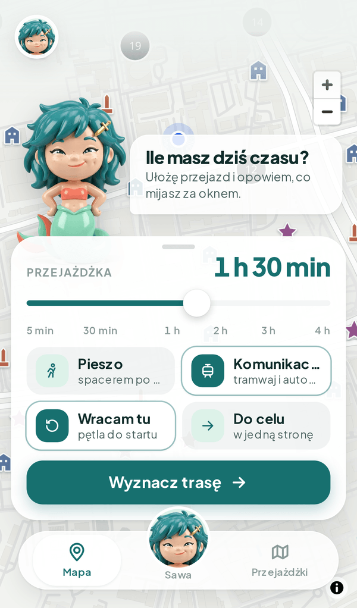
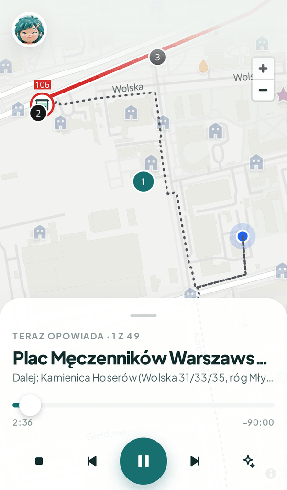
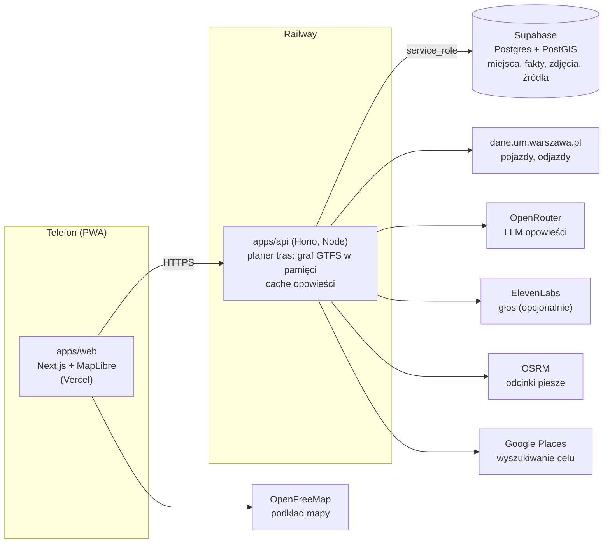

<div align="center">


# Sawa

**Syrenka-przewodniczka, która wie, co masz za oknem tramwaju.**

🔗 **[sawa-hackathon.vercel.app](https://sawa-hackathon.vercel.app)** · najlepiej na telefonie (działa jako PWA)

Warsaw Open Data Hackathon 2026 · 17–18.10 · 42 Warsaw

</div>

| Poznaj Sawę | Ile masz czasu? | Trasa na mapie | Opowieść na żywo |
|:---:|:---:|:---:|:---:|
|  |  |  |  |

## Problem

Według prognozy miasta w 2060 r. ok. 20% mieszkańców Warszawy to będą imigranci i ich potomkowie. Do tego codziennie jest w mieście ok. 600 tys. osób spoza niego, głównie dojeżdżających do pracy ([docs/08-badania-trendy.md](docs/08-badania-trendy.md)). Wielu z nich jeździ codziennie tymi samymi liniami i nie wie nic o mijanych ulicach. Przewodniki i audioprzewodniki są pisane dla turystów i ich wyznaczonych tras, nie dla zwykłego dojazdu do pracy.

## Rozwiązanie

Sawa to aplikacja na telefon dla nowych mieszkańców, dojeżdżających i każdego, kto jeździ po Warszawie tramwajem albo autobusem. Planuje przejazd komunikacją miejską pod Twoje zainteresowania i czas, a w trakcie jazdy opowiada o miejscach, które właśnie mijasz. Długość każdej opowieści dopasowuje do czasu dojazdu do następnego miejsca, liczonego z rozkładu ZTM i pozycji pojazdów na żywo.

### Jak to działa

1. **Onboarding:** wybierasz zainteresowania (historia, kultura, sport, przyroda), to, jak dobrze znasz miasto, styl opowieści i kto słucha (dorosły czy dziecko). Bez konta, profil zostaje w telefonie. Aplikacja działa po polsku i po angielsku.
2. **Trasa:** podajesz czas albo cel. Planer układa przejazd tramwajami i autobusami ZTM (z odcinkami pieszymi) tak, żeby po drodze było jak najwięcej miejsc pasujących do Ciebie.
3. **Jazda:** mapa pokazuje trasę, przystanki i pojazdy na żywo, a Sawa milczy, dopóki nie zbliżysz się do pierwszego miejsca.
4. **Opowieść:** przy każdym miejscu LLM układa krótką opowieść wyłącznie z faktów z naszej bazy (każdy ze źródłem). Opcjonalnie czyta ją głos Sawy. Sawa pamięta, co już słyszałeś, i nie powtarza się. Między miejscami może grać cicha muzyka w tle, składana na żywo w przeglądarce, bez plików nagrań (włącza się w menu Sawy).

## Założenia i ograniczenia

**Założenia:**

- Słuchacz jedzie tramwajem albo autobusem ZTM (albo idzie pieszo) i ma telefon, najlepiej ze słuchawkami.
- Bez konta: profil, ustawienia i historia wysłuchanych opowieści zostają w pamięci przeglądarki na telefonie.
- Sawa mówi tylko to, co jest w bazie faktów. Gdy o miejscu nie ma nic ciekawego, milczy, zamiast zmyślać.
- Długość opowieści wynika z czasu dojazdu do następnego miejsca, a ten z rozkładu i pozycji pojazdów.

**Ograniczenia:**

- Planer układa trasy z tramwajów, autobusów i odcinków pieszych. Metra, SKM i Kolei Mazowieckich nie obejmuje.
- Najwięcej miejsc ma baza na Woli i w Śródmieściu (wokół 42 Warsaw). W dalszych dzielnicach punktów jest mniej.
- Fakty sprawdzał automatycznie skrypt, ale tylko pod kątem lat. Nazwisk i liczb nikt nie zweryfikował ręcznie (szczegóły w sekcji „Użycie AI”).
- Gdy API miasta nie odpowiada, godziny odjazdów są szacowane z rozkładu GTFS, a pozycje pojazdów mogą być nieaktualne.

## Dane

### Zbiory z dane.um.warszawa.pl

| Zbiór | Endpoint (`/api/action/…`) | Do czego | Licencja |
|---|---|---|---|
| Lokalizacja pojazdów komunikacji miejskiej | `get_ztm_lokalizacja_pojazdow` | pojazdy na mapie na żywo, opóźnienie i prognoza dojazdu (korki) | CC BY, ZTM |
| Odjazdy linii z przystanku | `get_ztm_odjazdy_linii_z_przystanku` | godziny odjazdów z rozkładu dla każdego odcinka trasy | CC BY, ZTM |
| Otwarte boiska | `get_be_otwarte_boiska` | ok. 300 szkolnych terenów sportowych jako miejsca w kategorii „sport” (pobrane raz skryptem `scripts/fetch-otwarte-boiska.ts`) | CC BY |

Zapytania do API miasta idą tylko z naszego backendu (token `WAW_TOKEN`), przeglądarka nie łączy się z nim bezpośrednio. Podpisy źródeł są w odpowiedziach API (`attribution`) i w aplikacji.

### Inne otwarte źródła

| Źródło | Do czego | Licencja |
|---|---|---|
| GTFS Warszawy, [mkuran.pl](https://mkuran.pl/gtfs/) (dane ZTM) | graf linii, przystanki, kształty tras | dane ZTM, kształty © OpenStreetMap (ODbL) |
| OpenStreetMap | zabytki, kościoły, muzea, teatry, parki, obiekty sportowe; geokodowanie (Nominatim) | ODbL |
| Wikipedia, Warszawikia | fakty o miejscach | CC BY-SA |
| [warszawa1939.pl](https://warszawa1939.pl) | karty przedwojennych budynków (Śródmieście, Wola) | CC BY-NC |
| Wikimedia Commons | zdjęcia archiwalne, z autorem i licencją przy każdym | licencja przy zdjęciu |
| OpenFreeMap | podkład mapy | ODbL |
| OSRM (FOSSGIS) | odcinki piesze po chodnikach | ODbL |

Baza ma ok. 4500 miejsc ze źródłami i ok. 2900 zdjęć (Supabase, PostGIS). Opis zbierania i licencji: [docs/historia/README.md](docs/historia/README.md), [docs/historia/dzielnice/README.md](docs/historia/dzielnice/README.md).

## Architektura



Kontrakt API (zod) jest w `packages/shared` i jest wspólny dla web i api. Przeglądarka nie zna żadnych kluczy: Supabase, API miasta i LLM wołamy tylko z backendu. Szczegóły: [docs/12-plan-mvp.md](docs/12-plan-mvp.md), [docs/05-plan-architektury.md](docs/05-plan-architektury.md).

### Stack

| Warstwa | Technologia | Dlaczego |
|---|---|---|
| Frontend | Next.js 16 (App Router), React 19, Tailwind 4, Motion, Vercel | szybko zbudowaliśmy ekrany, a aplikację da się zainstalować na telefonie jak zwykłą (PWA) |
| Mapa | MapLibre GL, podkład OpenFreeMap | otwarte oprogramowanie i dane, bez klucza i opłat |
| Backend | Hono na Node, Railway | stały serwer trzyma w pamięci sieć linii ZTM, czeka na długie odpowiedzi modelu językowego i jako jedyny zna klucze |
| Kontrakt API | zod w `packages/shared` | frontend i backend korzystają z tych samych definicji danych, więc nie rozjeżdżają się |
| Baza | Supabase (Postgres + PostGIS) | szybko wyszukuje miejsca w danym obszarze mapy |
| Model językowy | OpenRouter, `google/gemini-3.5-flash-lite` | tani i szybki; model zmienia się jedną zmienną środowiskową (`OPENROUTER_MODEL`) |
| Głos | ElevenLabs `eleven_multilingual_v2` | naturalnie brzmiący polski; domyślnie włączony, wyłącza go `?voice=0` w adresie |
| Jakość kodu | TypeScript w trybie `strict`, testy Vitest, Biome, GitHub Actions | każdy PR automatycznie przechodzi sprawdzenie typów, testy i lint, zanim trafi do `main` |

## Użycie AI

Regulamin (§4 ust. 4) wymaga opisu zakresu użycia AI. Za wszystkie treści odpowiada zespół.

**W aplikacji:**

- **Opowieści Sawy** generuje LLM (OpenRouter, `google/gemini-3.5-flash-lite`) na żywo, wyłącznie z faktów z naszej bazy przypisanych do miejsca. Prompt zabrania dopisywania dat, liczb, nazwisk i wydarzeń spoza tych faktów. Tryb dla dzieci ma osobny prompt: prostszy język, te same fakty. Bez klucza LLM aplikacja czyta same fakty. Prompty: `apps/api/src/prompts/`.
- **Głos Sawy:** synteza mowy ElevenLabs (`eleven_multilingual_v2`, polski głos „Asia” z biblioteki ElevenLabs, wybrany na ucho). API trzyma nagrania w pamięci, więc powtórzona opowieść nie kosztuje drugi raz.

**Przy budowie:**

- **Kod:** każdy z 4 członków zespołu pracował z własnym agentem Claude Code. Kod powstał w czasie hackathonu (od 17.10, 11:00) przez PR-y do `main`. Każdy PR przechodził typecheck, lint i testy w CI, a zmiany przeglądał człowiek.
- **Dane:** skrypty pobrały teksty z Wikipedii (lokalny zrzut ZIM i API), Wikidaty, OSM, Commons, Warszawikii (API MediaWiki) i warszawa1939.pl oraz z API miasta. Fakty z artykułów Wikipedii i Warszawikii oraz z adresów w biogramach wyciągały agenty Claude Haiku. Pracowały tylko na pobranym tekście, bez dostępu do sieci, i każdy fakt ma źródło. Skrypt sprawdził, czy każdy rok z faktu występuje w źródle, a fakty, które nie przeszły, nie trafiają do opowieści. Nazwisk i liczb skrypt nie sprawdzał. Karty z warszawa1939.pl i tagi OSM weszły dosłownie, bez LLM. Angielskie nazwy i streszczenia miejsc to tłumaczenia agentów. W pierwszych dwóch rundach (okolica 42 Warsaw) agenty Haiku szukały też w sieci. Szczegóły: [docs/historia/](docs/historia/README.md), [docs/historia/dzielnice/](docs/historia/dzielnice/README.md).
- **Grafika:** awatar Sawy to obraz 32 z `google/nano-banana-2.1` (fal.ai). Wcześniej w 7 rundach szkiców sprawdziliśmy 10 modeli obrazów, m.in. GPT Image, Flux, Seedream i Ideogram. Ikonę aplikacji, pozy Sawy i 8 ikon zainteresowań w onboardingu zrobił `google/nano-banana-2.1/edit` z obrazem 32 jako referencją, a tło wycinał `fal-ai/birefnet/v2`. Ikony przystanku, tramwaju i autobusu na mapie to `flux-2-pro`, sceny z Sawą do prezentacji to `google/nano-banana-2-lite`. Znaczniki miejsc na mapie to glify SVG rysowane skryptem, bez modelu obrazów. Kierunek, prompty i wybór należały do zespołu, a wszystkie prompty i koszty są w [docs/awatar/](docs/awatar/README.md) i [docs/ui/](docs/ui/README.md).
- **Film i nagrania do pitchu:** nagranie demo składa Remotion z zapisu ekranu aplikacji (`tools/pitch-video/`). Głos Sawy w nagraniach i w filmie z tramwaju to plik wygenerowany przez aplikację (ElevenLabs), bez osobnego lektora AI.
- **Dokumentacja i plan:** analiza danych, PRD, plany i makiety ekranów powstawały razem z agentami ([docs/](docs/README.md)). Plan pitchu Paweł przygotował z agentem: research taktyk z artykułów, potem dwie rundy narady sześciu agentów w rolach znanych mówców i projektantów ([docs/pitch/plan-pitchu.md](docs/pitch/plan-pitchu.md)). Do 17.10, 13:30 prowadziliśmy dziennik promptów: [docs/ai-log.md](docs/ai-log.md).

---

## Dla developerów

Dokumentacja zespołu: [docs/README.md](docs/README.md). PRD: [docs/10-prd.md](docs/10-prd.md). Plan MVP: [docs/12-plan-mvp.md](docs/12-plan-mvp.md). Zasady kodu: [docs/11-zasady-pracy-i-kodu.md](docs/11-zasady-pracy-i-kodu.md).

### Wymagania

| Narzędzie | Wersja | Sprawdź |
|---|---|---|
| Node.js | **24 LTS** (min. 24) | `node -v` |
| pnpm | **12.14.0** (zapisana w `package.json`, pole `packageManager`) | `pnpm -v` |
| Git | dowolna aktualna | `git --version` |

#### 1. Node.js 24

**macOS** (Homebrew):

```bash
brew install node@24
brew link --force --overwrite node@24
```

**Windows** (PowerShell):

```powershell
winget install --id OpenJS.NodeJS.LTS -e
```

Potem zamknij i otwórz terminal (i edytor), żeby `node` był w `PATH`.

**Linux / alternatywa dla każdego systemu** ([nvm](https://github.com/nvm-sh/nvm)):

```bash
nvm install 24
nvm use 24
```

#### 2. pnpm 12

Najprościej, na każdym systemie:

```bash
npm install -g pnpm@12.14.0
```

Albo przez Corepack (wbudowany w Node 24; sam bierze wersję z `packageManager`):

```bash
corepack enable
```

Na Windows `corepack enable` wymaga terminala uruchomionego jako administrator. Jeśli nie masz uprawnień, użyj `npm install -g`.

#### 3. Sprawdzenie

```bash
node -v   # v24.x
pnpm -v   # 12.14.0
```

### Uruchomienie lokalne

```bash
git clone https://github.com/Pawel-Uhma/Sawa.git
cd Sawa
pnpm install
cp apps/api/.env.example apps/api/.env.local
cp apps/web/.env.example apps/web/.env.local
pnpm dev
```

- Web: http://localhost:3000
- API: http://localhost:8787/health

Sekrety (token dane.um.warszawa.pl, klucze Supabase i LLM) wpisujesz tylko do `.env.local`. Ten plik nie trafia do git. Aplikacja wstaje też bez kluczy: zamiast bazy API podaje kilka przykładowych miejsc, odjazdy liczy z rozkładu GTFS, a opowieść to same fakty bez LLM. Co włącza który klucz, opisuje `apps/api/.env.example`.

### Polecenia

| Polecenie | Co robi |
|---|---|
| `pnpm dev` | web i api naraz, z przeładowaniem |
| `pnpm test` | testy (Vitest) |
| `pnpm typecheck` | TypeScript we wszystkich pakietach |
| `pnpm lint` | Biome: lint i formatowanie (tylko sprawdza) |
| `pnpm format` | Biome: poprawia formatowanie i importy |
| `pnpm --filter @sawa/api add <pakiet>` | dodaje zależność do jednego pakietu (`@sawa/web`, `@sawa/shared`) |

Przed PR: `pnpm lint && pnpm typecheck && pnpm test`. To samo sprawdza CI.

### Struktura

```
apps/web         Next.js → Vercel
apps/api         Hono → Railway
packages/shared  kontrakt API (zod), funkcje geo
supabase/        migracje SQL
scripts/         seed danych i skrypty jednorazowe
docs/            dokumentacja i dane historyczne
```

### Problemy

- **`pnpm: command not found` po instalacji:** otwórz nowy terminal. Na Windows sprawdź, czy `%APPDATA%\npm` jest w `PATH`.
- **`ERR_PNPM_BAD_PM_VERSION` albo ostrzeżenie o wersji pnpm:** masz inną wersję niż 12.14.0, zainstaluj ją jak w punkcie 2.
- **Błędy po `git pull`:** ktoś zmienił zależności, odpal `pnpm install`.
- **Konflikt w `pnpm-lock.yaml`:** weź wersję z `main` i odpal `pnpm install`.
