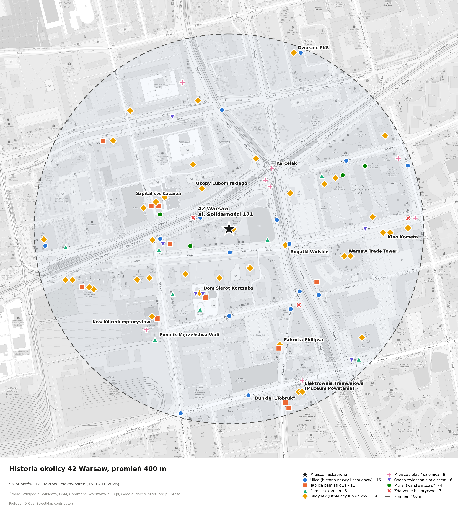

# Historia okolicy 42 Warsaw (promień 400 m)

Dane dla Sawy w trybie „co tu było?”. Środek: **al. Solidarności 171, Czyste (Wola), 52.2359, 20.9789**. Zebrane 15–16.10.2026 w dwóch rundach agentów AI (Haiku, 8 + 10 agentów), uzupełnione skryptem z warszawa1939.pl i Google Places, scalone i sprawdzone automatycznie.

## Ustalenia (15.10, Paweł)

- Jednostka to **punkt na mapie** z krótką historią. Sawa odzywa się, gdy jesteś blisko.
- Format: **GeoJSON + Markdown**. 17.10 ładujemy GeoJSON do MapLibre bez przepisywania.
- Treść: **fakty i ciekawostki ze źródłami**. Kwestie Sawy generuje LLM na żywo 17.10. Gotowych tekstów jej głosem nie piszemy (§4 ust. 3 regulaminu).
- Dodatki: linki do zdjęć archiwalnych z licencjami, streszczenie po angielsku, dawne nazwy ulic, ludzie związani z miejscem.

## Mapa

## Pliki

| Plik | Co jest w środku |
|---|---|
| [sawa-historia.geojson](sawa-historia.geojson) | **90 punktów, 773 fakty i ciekawostki**: 39 budynków (istniejących i dawnych), 16 ulic, 11 tablic, 9 miejsc, 8 pomników, 4 murale, 3 zdarzenia. Każdy ma fakty, ciekawostki, `summary_en`, źródła i odległość od wejścia. 65 zdjęć archiwalnych, 62 punkty mają pole `dzis` (co jest tu teraz, z Google Places) |
| [ludzie.json](ludzie.json) | 12 osób, w tym 7 w promieniu (Korczak, Wilczyńska, Gałczyński, Tchorek, Chopin, Świerczewski, Weinstein). Osoby spoza promienia mają `poza_promieniem: true` |
| [os-czasu.json](os-czasu.json) | 33 wydarzenia, od 1573 (elekcja) do 2016 (Warsaw Spire), PL i EN |
| [zdjecia.json](zdjecia.json) | 31 zdjęć archiwalnych z Wikimedia Commons, licencje z metadanych. Są też dopięte do punktów w GeoJSON (pole `zdjecia`) |
| [surowe/](surowe/) | Wyniki agentów (runda 1: `1-…8-`, runda 2: `r2-*`), dane z warszawa1939.pl (`r2-11`), wynik Google Places (`google-places.json`, 777 miejsc), wyciąg z OSM i `scalenie-log.txt` (co połączono, co odrzucono i dlaczego) |

## Najmocniejsze miejsca do demo

| Miejsce | Odległość | Dlaczego |
|---|---|---|
| Kercelak | 150 m | Największy bazar przedwojennej Warszawy (od 1867 r.), gwara, „Tata Tasiemka”, felietony Wiecha |
| Okopy Lubomirskiego | 120 m | Wał z 1770 r. zbudowany przeciw dżumie. Stąd wzięły się nazwy Okopowej, Przyokopowej i Towarowej |
| Dom Sierot Korczaka | 145 m | Krochmalna 92, dziś Jaktorowska 6. Korczak i Wilczyńska prowadzili go od 1912 do 1942 r. Obok rośnie „Dąb doktora Korczaka” |
| Szpital św. Łazarza | 160 m | 5 sierpnia 1944 r., w czasie Rzezi Woli, zginęło tu ok. 1200 osób |
| Kościół redemptorystów, Karolkowa 49 | 240 m | 6 sierpnia 1944 r. zginęło 30 zakonników. Tablica Tchorka ma nieścisły napis |
| Elektrownia Tramwajowa / Muzeum Powstania | 360 m* | Pierwszy tramwaj elektryczny pojechał w 1908 r. Obok stoi bunkier „Tobruk” przewieziony tu w 2004 r. |
| Al. Solidarności | pod wejściem | Dawniej Leszno, potem Trasa W-Z i od 1948 r. al. Świerczewskiego. Obecna nazwa od 1991 r. |

\* Punkt elewacji od strony Przyokopowej. Środek budynku leży ok. 430 m od wejścia.

## Jak czytać pola

- `pewnosc`: wysoka / srednia / niska, w ocenie agenta.
- `do_weryfikacji`: fakty, których daty skrypt nie znalazł w tekście źródłowego artykułu Wikipedii (23 z 773). Zwykle pochodzą z innego źródła, np. korczak.ckc.uw.edu.pl albo dzieje.pl.
- `zrodla_wikipedia_sprawdzone: false`: punkt ma tylko źródła spoza Wikipedii (warszawa1939.pl, Google, OSM, prasa).
- `dzis`: obiekty z Google Places stojące dziś w tym miejscu (do 25 m), z linkiem do Google Maps. Rekordy z id `g-*` pochodzą tylko z Google i mają historię do uzupełnienia.
- `istnieje`: czy budynek stoi do dziś (wg warszawa1939.pl „OBIEKT NIE ISTNIEJE”).
- `lokalizacja: przyblizona`: punkt jest na ulicy albo przy obiekcie, a nie w dokładnym miejscu zdarzenia.
- `uwagi`: sprzeczności między źródłami, na przykład liczby ofiar albo daty nadania nazw.

**Ograniczenie weryfikacji:** skrypt sprawdzał tylko, czy lata z faktu występują w źródle (692 z 773 przeszło, 58 faktów pochodzi spoza Wikipedii i nie było z czym porównać). Nie sprawdzał nazwisk ani liczb. Agenci często czytali Wikipedię przez streszczenia, a nie dosłowny tekst. Zanim fakt trafi do pitchu, trzeba go przeczytać w źródle.

## Do sprawdzenia na miejscu w sobotę (zrób zdjęcia)

- [ ] Tablica „Zdobycie Elektrowni Tramwajowej”: możliwe, że dotyczy elektrowni na Powiślu.
- [ ] Tablica „Stanisław Conrad” (265 m): nie wiadomo, kim był.
- [ ] 4 tablice Tchorka bez napisu w OSM (`tablica-tchorka-osm-*`).
- [ ] Tablica pracowników Szpitala św. Łazarza i tablica nauczycieli i uczniów przy Karolkowej 56.
- [ ] Co stało na działce al. Solidarności 171 przed 1944 r. Jedyny trop to zakłady Norblina, niepotwierdzony.

## Czego brakuje

- Zdjęcia: brak dla Elektrowni Tramwajowej, Szpitala św. Łazarza, muru getta, Okopowej, Ogrodowej, Leszna i Żytniej. NAC (szukajwarchiwach.gov.pl), Polona i fotopolska.eu nie zostały przeszukane.
- Skwer Hanki Bielickiej i Skwer Gwary Warszawskiej: brak źródeł o nazwaniu.
- Sprzeczności do rozstrzygnięcia: Jaktorowska nazwana w 1916 czy w 1970 r.; granice getta na Chłodnej w grudniu 1941 r.; liczba ofiar wśród redemptorystów (24 czy 30).
- Poza promieniem, ale blisko i mocne: browar Haberbuscha i Schielego (ok. 600 m), Singer przy Krochmalnej 10 (540 m), Kamienica pod Zegarem i Czerniaków przy Chłodnej 20 (800 m), kładka na Chłodnej. Opisy są w faktach ulic, bez osobnych punktów.

## Licencje i warunki

- Wikipedia: CC BY-SA. OSM: ODbL. Commons: licencja przy każdym zdjęciu.
- **warszawa1939.pl: CC BY-NC.** Na hackathonie (niekomercyjnie) wolno, z podpisem. Przy komercjalizacji trzeba to zmienić.
- **Google Places:** warunki Google pozwalają trzymać treści najwyżej 30 dni (bezterminowo tylko `place_id`). Po hackathonie dane z Google odświeżamy przez API albo usuwamy.

## Runda 2 (16.10): co zadziałało, a co nie

- Najwięcej dało bezpośrednie pobranie kart z warszawa1939.pl: Rogatki Wolskie Kubickiego, kino Kometa, kamienica Machleida, szkoła przy Karolkowej z 1925 r., fabryka Philipsa, kamienica Węgiełka, przedwojenne zdjęcia.
- Agenci Haiku przeszukujący blogi i prasę dali mało (2–16 rekordów na agenta): Warszawikia blokuje boty (HTTP 402), wiele artykułów to PDF-y, a Nominatim i Overpass zaczęły odrzucać zapytania przy kilku agentach naraz.
- Odrzucone jako leżące poza 400 m mimo przypisania im przez agentów współrzędnych ulicy: Sąd na Lesznie, Leszno 13, brama i kładka przy Żelaznej, Koszary Mirowskie, kino „Czary”, przedwojenne Leszno 81–84 i 100. Pełna lista w `surowe/scalenie-log.txt`.

## Na 17.10

GeoJSON wczytujemy jako źródło MapLibre. Gdy użytkownik jest w promieniu ok. 50 m od punktu, LLM dostaje `fakty`, `ciekawostki` i `ludzie` tego punktu i układa z nich wypowiedź Sawy. Do pitchu: wszystkie dane pochodzą z otwartych źródeł (Wikipedia CC BY-SA, OSM ODbL, Commons), więc trzeba je podpisać w aplikacji.
